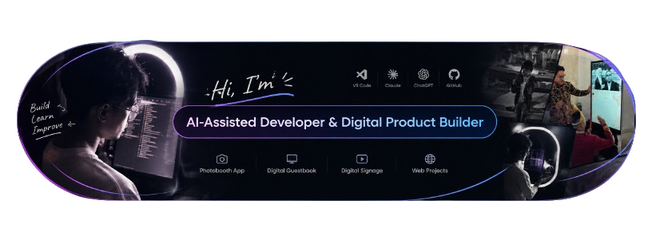

<!--
**Arzyyzy/Arzyyzy** is a ✨ _special_ ✨ repository because its `README.md` (this file) appears on your GitHub profile.

Here are some ideas to get you started:

- 🔭 I’m currently working on ...
- 🌱 I’m currently learning ...
- 👯 I’m looking to collaborate on ...
- 🤔 I’m looking for help with ...
- 💬 Ask me about ...
- 📫 How to reach me: ...
- 😄 Pronouns: ...
- ⚡ Fun fact: ...
-->
# Halo, saya Arif Rahman Hakim 👋

### AI-Assisted Developer · Digital Product Builder

Saya membangun solusi digital dengan memadukan pemahaman dasar pemrograman, teknologi kreatif, dan AI sebagai pendamping pengembangan.

Saat ini, saya berfokus pada aplikasi photobooth, digital guestbook, integrasi perangkat, dan pengalaman digital untuk industri kreatif dan event.

##  Proyek Unggulan

 **[Lumina Booth](https://github.com/Arzyzyy/LuminaBooth)**  
Aplikasi photobooth berbasis Electron dengan fokus pada integrasi kamera DSLR, pengelolaan foto, dan pengalaman pengguna.

 **Digital Signage Guestbook**  
Integrasi website guestbook dengan Android touchscreen dan Xibo Player untuk menghadirkan pengalaman interaktif dalam acara.

 **Video Digital Guestbook — Coming Soon**  
Eksplorasi pengalaman guestbook berbasis video untuk mengabadikan pesan dan momen dari para tamu.

 **[ArifPorto](https://github.com/Arzyzyy/ArifPorto)**  
Portofolio pribadi untuk menampilkan proyek dan eksplorasi teknologi kreatif.

**[Niskala](https://github.com/Arzyzyy/Niskala)**  
Proyek website di bidang pernikahan dan industri kreatif.

##  Technologies & Tools

  

##  AI-Assisted Development

  
  
  

##  Mari Terhubung

  
  
  
  

## My GitHub Stats

  
  

  

- **Email:** [rarif9534@gmail.com](mailto:rarif9534@gmail.com)
- **LinkedIn:** [arif-rahman-hakim](https://www.linkedin.com/in/arif-rahman-hakim-5a141836b/)
- **Instagram:** [@arifrahmanh4kim](https://www.instagram.com/arifrahmanh4kim/)
- **GitHub:** [@Arzyzyy](https://github.com/Arzyzyy)