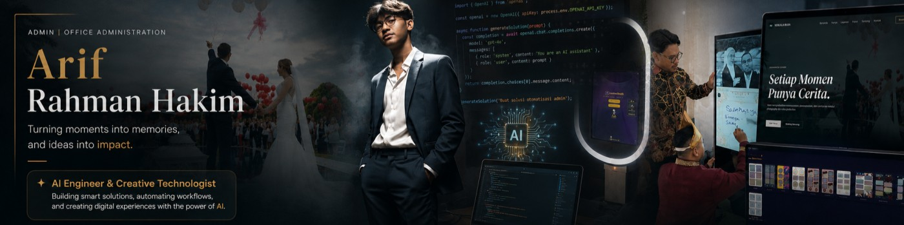

<!--
**Arzyyzy/Arzyyzy** is a ✨ _special_ ✨ repository because its `README.md` (this file) appears on your GitHub profile.

Here are some ideas to get you started:

- 🔭 I’m currently working on ...
- 🌱 I’m currently learning ...
- 👯 I’m looking to collaborate on ...
- 🤔 I’m looking for help with ...
- 💬 Ask me about ...
- 📫 How to reach me: ...
- 😄 Pronouns: ...
- ⚡ Fun fact: ...
-->
# Halo, saya Arif Rahman Hakim 👋

### Pengembang Perangkat Lunak · Teknologi Kreatif · Solusi Digital untuk Event

Saya mengembangkan aplikasi dan pengalaman digital yang menggabungkan perangkat lunak, teknologi kreatif, dan kebutuhan nyata di lapangan.

Saya tertarik membangun solusi yang bukan hanya berfungsi secara teknis, tetapi juga mudah digunakan, dapat dikembangkan lebih lanjut, dan memberikan pengalaman yang baik bagi penggunanya.

Saat ini, saya berfokus pada pengembangan aplikasi photobooth, sistem digital guestbook, website interaktif, serta eksplorasi integrasi perangkat keras dan perangkat lunak untuk kebutuhan industri kreatif dan event.

---

## 🚀 Proyek yang Sedang Saya Kembangkan

### 📸 Lumina Booth — Photobooth Application

**Status: Pengembangan dan penyempurnaan**

Aplikasi photobooth berbasis Electron yang dikembangkan untuk mendukung kebutuhan operasional photobooth dalam acara.

Fokus pengembangan meliputi:
- Integrasi kamera DSLR dan workflow pengambilan foto.
- Pengelolaan frame, layout foto, dan hasil akhir.
- Manajemen sesi foto dan penyimpanan hasil.
- Integrasi layanan backend dan komunikasi antarproses aplikasi.
- Pengujian, debugging, keamanan, dan kesiapan aplikasi untuk digunakan.

Teknologi utama: `Electron` · `JavaScript` · `Node.js` · `Camera Integration`

Repository: [Lumina Booth](https://github.com/Arzyzyy/LuminaBooth)

### 🖊️ Digital Signage Guestbook

**Status: Pengembangan dan integrasi sistem**

Proyek yang menggabungkan website Digital Guestbook dengan perangkat layar sentuh Android dan sistem digital signage untuk kebutuhan acara, khususnya pernikahan.

Konsep yang dikembangkan adalah menampilkan slideshow acara pada satu bagian layar, sementara bagian lainnya digunakan oleh tamu untuk menulis pesan secara langsung melalui website.

Fokus pengembangan meliputi:
- Integrasi website Digital Guestbook dengan perangkat Android 12 touchscreen.
- Eksplorasi penggunaan Xibo Player sebagai media penayangan slideshow.
- Penyesuaian tampilan antarmuka untuk penggunaan layar sentuh.
- Perancangan alur interaksi antara slideshow dan area penulisan pesan.
- Pengembangan mekanisme penyimpanan pesan agar dapat digunakan secara andal.

Teknologi dan platform: `Android 12` · `Xibo Player` · `Web Application` · `Touchscreen Interface`

### 🎥 Video Digital Guestbook

**Status: Perancangan — Coming Soon**

Proyek pengembangan pengalaman video guestbook digital yang ditujukan untuk mengabadikan pesan, ucapan, dan momen dari para tamu dalam sebuah acara.

Proyek ini dirancang sebagai pengembangan tersendiri dari konsep guestbook berbasis teks, dengan fokus pada pengalaman merekam dan menyimpan pesan video.

### 🌐 ArifPorto — Personal Portfolio

**Status: Pengembangan**

Website portofolio pribadi untuk mendokumentasikan proyek, menampilkan hasil karya, dan memperkenalkan perjalanan saya dalam bidang pengembangan perangkat lunak dan teknologi kreatif.

Fokus pengembangan meliputi eksplorasi desain interaktif, visualisasi 3D, animasi, serta penyajian studi kasus proyek.

Repository: [ArifPorto](https://github.com/Arzyzyy/ArifPorto)

### 🌿 Niskala

**Kategori: Proyek web di bidang kreatif**

Proyek website dalam ranah pernikahan dan industri kreatif. Proyek ini menjadi bagian dari pengalaman saya dalam mengembangkan solusi digital untuk kebutuhan visual dan layanan kreatif.

Repository: [Niskala](https://github.com/Arzyzyy/Niskala)

---

## 🛠️ Teknologi dan Lingkup Pengembangan

**Pengembangan Aplikasi**
- Electron
- JavaScript
- Node.js
- TypeScript

**Web Development**
- React
- Vite
- HTML & CSS
- Three.js dan React Three Fiber

**Backend dan Integrasi**
- Supabase
- REST API
- Inter-Process Communication (IPC)
- Integrasi kamera dan perangkat eksternal

**Tools dan Workflow**
- Git & GitHub
- Visual Studio Code
- Debugging dan pengujian aplikasi
- AI-assisted development

Teknologi di atas mencerminkan lingkup proyek yang saya kerjakan dan eksplorasi. Penggunaan setiap teknologi disesuaikan dengan kebutuhan masing-masing proyek.

---

## 🤖 AI-Assisted Development

Dalam proses pengembangan, saya memanfaatkan AI sebagai alat bantu untuk mempercepat eksplorasi, analisis, implementasi, dan pemecahan masalah teknis.

Tools yang biasa saya gunakan meliputi:
- **Claude AI** — membantu analisis kode, perencanaan arsitektur, dan evaluasi implementasi.
- **ChatGPT** — membantu penalaran teknis, penyusunan strategi pengembangan, dokumentasi, dan debugging.
- **Visual Studio Code Agent** — membantu pengerjaan dan perubahan kode langsung di lingkungan proyek.
- **GitHub dan GitHub Copilot/Agent** — digunakan sesuai kebutuhan untuk mendukung workflow pengembangan berbasis repository.

AI saya gunakan sebagai pendamping kerja, bukan sebagai pengganti proses pengambilan keputusan teknis. Saya tetap berfokus pada pemahaman implementasi, pemeriksaan perubahan, pengujian, dan evaluasi hasil sebelum sebuah fitur dianggap siap.

Bagi saya, kemampuan menggunakan AI secara efektif adalah bagian dari workflow pengembangan modern, terutama ketika mengerjakan proyek yang melibatkan banyak komponen dan integrasi.

---

## 🎯 Fokus Pengembangan

- Membangun aplikasi yang stabil dan mudah dipelihara.
- Mengintegrasikan perangkat keras dengan aplikasi perangkat lunak.
- Mengembangkan solusi digital untuk industri event dan kreatif.
- Meningkatkan kualitas UI/UX dan interaksi pengguna.
- Menerapkan praktik debugging, pengujian, keamanan, dan dokumentasi.
- Memanfaatkan AI untuk mendukung proses engineering secara terarah.

---

## 🤝 Mari Terhubung

Saya terbuka untuk berdiskusi, berkolaborasi, dan bertukar ide mengenai pengembangan perangkat lunak, teknologi kreatif, integrasi perangkat, serta solusi digital untuk kebutuhan event.

- **GitHub:** [@Arzyzyy](https://github.com/Arzyzyy)
- **Portofolio:** [arifrahmanhakim-porto.vercel.app](https://arifrahmanhakim-porto.vercel.app)
- **Instagram:** [@arifrahmanh4kim](https://www.instagram.com/arifrahmanh4kim)

---

*Terus belajar, membangun, menguji, dan menyempurnakan solusi digital melalui proses engineering yang terarah.*